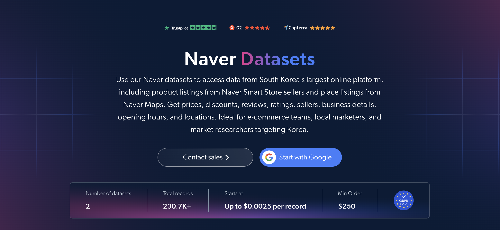

# Naver-smartstore-dataset-samples

<h2>A sample dataset of 1000 Naver products</h2>

<a href="https://brightdata.com/products/datasets/naver">
   
</a>

A Naver dataset sample of 1000 Smart Store products. Dataset was extracted using the <b>Bright Data API</b>.

<h2>Some of the data points that are included in the dataset:</h2>

* ```url```: URL of the Naver product page
* ```product_id```: Unique identifier for each product
* ```title```: Title of the product
* ```original_price```: Price before discount
* ```final_price```: Price after discount
* ```discount_rate```: Discount percentage applied to the product
* ```currency```: Currency of the product price
* ```description```: Short description or overview of the product
* ```images```: List of product image URLs
* ```breadcrumbs```: Category path of the product
* ```category_name```: Category the product belongs to
* ```sold_out```: Whether the product is sold out
* ```delivery_fee_type```: Type of delivery fee (free, conditional or paid)
* ```free_shipping_minimum```: Minimum order amount required for free shipping
* ```arrival_guarantee```: Whether guaranteed fast delivery is available
* ```average_rating```: Average customer rating of the product
* ```total_reviews```: Total number of customer reviews
* ```top_reviews```: Top customer reviews, including rating, content and media
* ```variations```: Product variations, such as sizes or colors
* ```sellers```: Sellers offering the product

And a lot more.

This is a sample subset which is derived from the "Naver Products (public data)"
dataset which includes more than <b>9,400 products</b>.

Available dataset file formats: <b>JSON, NDJSON, JSON Lines, CSV, XLSX, or Parquet. Optionally, files can be compressed to .gz</b>.

Dataset delivery type options: <b>Email, API download, Webhook, Amazon S3, Google Cloud storage, Google Cloud PubSub, Microsoft Azure, Snowflake, SFTP</b>.

Update frequency: <b>Once, Daily, Weekly, Monthly, Quarterly, Biannual, or Custom basis</b>.

Data enrichment available as an addition to the data points extracted: <b>Based on request.</b>

<b>[Get the full Naver dataset](https://brightdata.com/products/datasets/naver)</b>.

<a href="https://brightdata.com/products/datasets/naver">
   
</a>

<h2>What are the Naver datasets use cases?</h2>

<h3>1. Korean e-commerce pricing</h3>
Businesses use Naver datasets to track prices and discounts across Naver Smart Store listings. By comparing original prices, final prices and discount rates by category, companies can benchmark their pricing in the Korean market and spot competitor promotions early.

<h3>2. Seller and delivery analysis</h3>
Brands and marketplace teams analyze Naver data to compare Smart Store sellers on delivery fees, free-shipping thresholds and arrival guarantees. This shows which fulfillment and shipping strategies help competitors win Korean shoppers.

<h3>3. Review and reputation tracking</h3>
Companies use ratings, review counts and top reviews to measure how products are received and what Korean customers value. Monitoring this feedback reveals product strengths, recurring complaints and unmet needs that can guide product development.

<h2>Free access to web scraping tools and datasets for academic researchers and NGOs</h2>

The Bright Initiative offers access to Bright Data's <b>[Web Scraper APIs](https://brightdata.com/products/web-scraper)</b> and <b>[ready-to-use datasets](https://brightdata.com/products/datasets)</b> to leading academic faculties and researchers, NGOs and NPOs promoting various environmental and social causes. You can submit an application <b>[here](https://brightinitiative.com)</b>.
